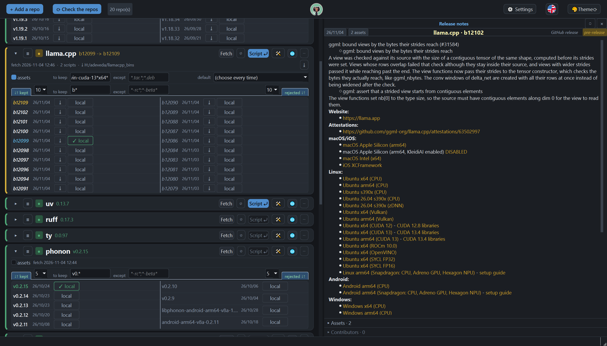

<p align="center">
  
</p>

<h1 align="center"><font size="7">ReleaseWatch</font></h1>

<h2 align="center"><font size="6">
  <p>
    <b>English</b> |
    <a href="./readme_fr.md">Français</a>
  </p>
</font></h2>

<p align="center"><font size="4"><em>
A local graphical interface that watches the releases of the GitHub repositories you pick: one banner per repository, two version columns (the ones you keep, the ones you set aside), configurable filters on tags and on assets, and a local version that <strong>you designate yourself</strong> so you can tell at a glance what is up to date. You can attach your own scripts to each repository (update, build, deploy) and re-run them with one click. Nothing is sent anywhere else: the application only reads the public GitHub API, over HTTPS.
</em></font></p>

<p align="center">
  
</p>

<div align="center"><font size="4">
<strong>

[⬇️ Download](#download)
[⚙️ Installation](#installation)
[🚀 Features](#features)
[⌨️ Keyboard Shortcuts](#keyboard-shortcuts)
[🗂️ File Structure](#file-structure)
[🧱 Tech Stack](#tech-stack)
[📜 License](#license)

</strong></font>

</div>

- **Platform**: Windows 10/11 x64 and Linux (`.bat`/`.cmd`/`.ps1` scripts on one side, `.sh`/`.bash`/`.zsh` on the other — see [Linux](#linux)).
- **Interface**: French by default, one click on the flag in the action bar switches to English.
- **No account, no token, no data sent.** The application only reads the public GitHub API, over HTTPS.

## Download

[Releases](../../releases) carries three files for every published version:

| File | What it is |
| ---- | ---------- |
| `ReleaseWatch-<version>-windows-x64.zip` | the Windows executable, unpacked into a folder (separate `Qt6*.dll`, replaceable) |
| `ReleaseWatch-<version>-source-windows-x64.zip` | the source, line endings set for Windows |
| `ReleaseWatch-<version>-source-linux-x64.zip` | the same source, without the Windows line-ending rule |

The executable is built by [the publication workflow](.github/workflows/release.yml) and started headless as a last check, so the published file is the file that was tested. Building it yourself is described in [CONTRIBUTING.md](CONTRIBUTING.md).

---

## Features

- Watches as many GitHub repositories as you like, stacked as banners you can reorder by dragging.
- Fetches the 25 most recent versions (tags when a repository has no releases) and shows them in two columns.
- Filters tags with two glob patterns: "keep" and "except".
- Fetches and filters the **assets** of each version, with a "default" asset and a download button per row.
- Compares the newest accepted version against the **designated local version**, in one click.
- Shows the Markdown release notes, with clickable assets and contributors.
- Runs your own scripts (`.bat`, `.cmd`, `.ps1`), preconfigured per repository, in their own console.
- Reloads colours and stylesheet without restarting (`Ctrl+Shift+P`), so you can tweak `app/palette.py` and `resources/dark.qss`.

## What ReleaseWatch does not do

- **It never looks at what is installed on the machine.** The local version is a value that is entered or designated; the green dot means "the newest accepted version is the declared local version", not "verified on disk".
- **It installs nothing.** It can download an asset (`.part`, then rename), never run it.
- **Private repositories are not supported**: without a token a private repository answers 404 and the banner goes to error.
- **Scripts are handed to the system's own interpreters**: `cmd.exe` and `powershell.exe` on Windows (`.bat`, `.cmd`, `.ps1`), the interpreter named in the shebang on Linux (`.sh`, `.bash`, `.zsh`). A script written for one of the two systems is refused on the other, with the reason shown.
- No GitHub token either: see [GitHub rate limit](#github-rate-limit).

---

## Requirements

|                      |                                                                                                       |
| -------------------- | ----------------------------------------------------------------------------------------------------- |
| Python               | 3.13 (see `.python-version`)                                                                          |
| Package manager      | [uv](https://docs.astral.sh/uv/) (the repository ships `uv.lock`, pinned versions)                    |
| Runtime dependencies | PySide6-Essentials ≥ 6.12 (Qt 6, LGPL), requests ≥ 2.34                                               |

The **`pyside6` metapackage is deliberately not used**: it drags in QtWebEngine, QtPdf, Qt Multimedia and the ffmpeg libraries, which are GPL and which this application never imports. `pyside6-essentials` covers everything that is used, including the SVG support behind the flag icons. See [THIRD-PARTY-NOTICES.md](THIRD-PARTY-NOTICES.md).

## Installation

### Windows

```bat
uv sync
uv run python main.py
```

The `data\` folder is created on the first save, next to the application.

### Linux

The launcher accepts `.sh`, `.bash` and `.zsh`, run by the interpreter announced in their shebang (fallback `/bin/sh`). The script opens in a terminal emulator looked up on the `PATH` — `x-terminal-emulator`, `gnome-terminal`, `konsole`, `xfce4-terminal`, `mate-terminal`, `lxterminal`, `xterm`, `alacritty`, `kitty`, `foot` — and the window stays open; force one with `RELEASEWATCH_TERMINAL=tilix`. With no terminal, or no graphical session, the output goes to a log in `data/launches/` and its path is shown in the status bar.

The child process never inherits the application environment: neither its venv, nor its `PATH`, nor its `uv` variables, nor an `LD_PRELOAD` pointing inside the application folder. Windows scripts (`.bat`, `.cmd`, `.ps1`) are refused on Linux, and the other way around — a `state.json` coming from Windows still loads, its scripts simply show as refused. Asset names stay sanitized the Windows way: a Windows-safe name is legal on Linux.

Qt also needs system libraries:

```bash
sudo apt-get install libgl1 libegl1 libxkbcommon0
uv sync
uv run python main.py
```

---

## First steps

1. Top bar: click **`+ Ajouter un repo`** (Add a repository), paste `https://github.com/owner/repo`, click **`Vérifier`** (the API is queried and the title is pre-filled), then **`Ajouter`**.
2. On the banner: **`Fetch`**, or **`⟳ Vérifier les repos`** at the top for every banner that is not excluded.
3. Filter row: the two combos set the caps ("kept versions" on the left, "rejected or outdated" on the right); the two **`à garder`** / **`sauf`** fields take `;`-separated globs, e.g. `v0.2.*` and `*-rc*;*-beta*`. The two small buttons **`↓↑ retenues`** and **`rejetées ↓↑`** show or hide each column.
4. Tick **`assets`** to enable asset collection: two glob fields to keep or discard them, and a **`par défaut`** combo choosing which asset the download button offers. Unticking hides the whole asset row.
5. On a version row, click **`locale`** to designate the installed version. The banner's **`⋯`** menu also allows typing it in by hand.
6. Click a version to read its notes in the right panel (resizable, `Ctrl`+scroll wheel changes the text size).
7. **`🛠`** attaches scripts to the repository, **`Script ⤶`** runs them, **`🌐`** opens the repository page in the browser.
8. **`≡`** drags the banner to reorder it, **`⊘`** excludes it from the global check, **`▾`** collapses the banner to its header row.

## Version rows

Each row carries the version, a short date, the asset download button (when assets are enabled) and the **`locale`** button. Its role is carried by its colour, and the full explanation is in its tooltip.

| Row role                  | Meaning                                                                 |
| ------------------------- | ----------------------------------------------------------------------- |
| Newest accepted version   | The most recent one accepted by the banner filter                       |
| Newest accepted + local   | It is also the designated local version: nothing to do                  |
| Local, not the newest     | The designated local version is older than the newest accepted one      |
| Accepted but past the cap | Accepted by the filter, too far down to fit in the left column          |
| Refused by the pattern    | Rejected by "keep" / "except": never compared against the local version |
| In between                | Accepted by the filter, between the two ends                            |

## Banner status

The visible status is **a coloured dot**, nothing else; the word only lives in the tooltip so it cannot steal width from the title.

| Status               | Meaning                                                     |
| -------------------- | ----------------------------------------------------------- |
| Up to date           | The newest accepted version is the declared local version   |
| New version          | The newest accepted version is newer than the local version |
| Outside releases     | The local version matches no accepted version               |
| Local version to set | No local version designated yet                             |
| Fetch error          | Fetching failed (missing repository, rate limit, network)   |

## Release notes

Right side panel: the Markdown body of the release, with date / asset count / source / pre-release chips, then two clickable sections — **Assets** (each network asset is a full-width button) and **Contributors**. An `http://`, `file://` or other link is refused and reported in the status bar: only `https://` links open, after a confirmation.

## Scripts

- Accepted extensions: `.bat`, `.cmd`, `.ps1` on Windows; `.sh`, `.bash`, `.zsh` on Linux. A `.ps1` runs through `powershell.exe -NoExit -ExecutionPolicy Bypass -File`; a shell script runs through the interpreter announced in its own shebang (`#!/usr/bin/env bash` → `/usr/bin/env bash`), with `/bin/sh` as fallback.
- The path must be **absolute**: a relative path is refused, never resolved blindly. Shell metacharacters (`" & | < > ^`) in a path are refused at launch, on both systems.
- Each script starts in **its own folder** (the one provided, if any) with an environment scrubbed of the application's venv: a script calling `python` finds the environment Python, not ReleaseWatch's.
- Nothing is passed through a shell: the command line is built as a list.
- On Windows each script keeps its own console. On Linux the script is handed to a terminal emulator looked up on the `PATH`; with no terminal or no graphical session, its output goes to a log under `data/launches/` and the status bar shows that path, so a launch can never be silent.

## Where the state is kept

`data/state.json`, **next to the application** (not in AppData, not in the user profile). In a built executable it is the folder of the executable: state, backups and launch logs stay next to the `.exe`, while the theme and icons stay read-only inside the package.

- watched repositories with all their settings, fetched versions, designated local version;
- global settings (default version count, download folder), language, window geometry, notes panel width and font size.

Atomic write with a `state.json.bak` backup, a stored-rows cap that follows what the two columns show (kept versions + rejected versions, 50 rows as the ceiling — an older, bigger file is truncated rather than rejected), and defensive reading: a hand-mangled `state.json` is cleaned field by field instead of crashing the application.

## GitHub rate limit

Without a token, the anonymous API allows **60 requests per hour per IP**. The application takes two precautions: at most two concurrent requests, and a widened fetch window (`min(50, 3 × (kept versions + rejected versions))`) because tag filtering happens after the response arrives. A 403/429 error is shown on the banner with the remaining wait time.

## Security choices

A few non-negotiable rules in the code:

- HTTPS only, and servers restricted to `github.com` / `githubusercontent.com` plus an exact host allowlist.
- `allow_redirects=False` on every request: redirects are followed by hand, one hop at a time, each hop re-validated (HTTPS + allowlist) and capped at 3 hops. That is what blocks a redirect to a site imitating GitHub. Setting `session.max_redirects = 0` instead looks stricter but is not: requests still resolves the first redirect internally and raises `TooManyRedirects`, so every asset download would fail.
- `session.trust_env = False`: no system proxy, no `~/.netrc`. `verify = True` hardcoded.
- Asset names come from the network: they go through a sanitiser (path traversal, Windows reserved names, dangerous characters, length).
- A download writes `.part` then renames; an error leaves a clean `.part`, never a half-written file.
- Notes links: `https://` only, filtered twice (panel, then open).

## Keyboard shortcuts

| Shortcut or gesture           | Effect                                                                         |
| ----------------------------- | ------------------------------------------------------------------------------ |
| `Ctrl+Shift+P`                | Reloads the colour palette and the stylesheet without restarting               |
| Click a version row           | Gives the row focus and shows its notes                                        |
| `↑` / `↓` (on a row)          | Moves to the previous / next version row                                       |
| `Enter` or `Space` (on a row) | Shows that row's notes                                                         |
| Drag `≡`                      | Reorders banners (the insertion bar marks the destination)                     |
| `⊘`                           | Excludes the banner from "⟳ Vérifier les repos" (individual fetch still works) |
| `▾`                           | Collapses the banner to its header row                                         |
| Flag (top bar)                | Switches the interface between French and English                              |

## Development

```bash
uv run pytest                     # 225 collected tests, offscreen interface, no network at all
ruff check .                      # lint (rules and 120-character width come from ruff.toml, in the repository)
ruff format --check .             # the same layout, checked instead of applied
ty check .                        # types
uv run python tools/audit_net.py  # zero-trust audit of the network code (63 checks)
```

[`.github/workflows/ci.yml`](.github/workflows/ci.yml) runs those same controls on Windows **and** on
Linux, in parallel.

## Tech stack

| Part      | Choice                                                                        |
| --------- | ----------------------------------------------------------------------------- |
| Language  | Python 3.13                                                                   |
| Interface | PySide6-Essentials 6.12 (Qt 6, LGPL v3)                                       |
| Network   | requests 2.34 (Apache-2.0), GitHub REST API over HTTPS                        |
| Tooling   | uv, `uv.lock` (pinned versions)                                               |
| Tests     | pytest (225 collected tests, interface driven offscreen, no network call)     |
| Quality   | ruff (lint + layout), ty (types), `tools/audit_net.py` (network audit)        |
| Theming   | Python palette + `.qss` stylesheet with `$token` placeholders                 |
| Packaging | PyInstaller in `--onedir`, pinned in `requirements-build.txt`, built in CI    |

Dependency direction, never the other way round: `main.py` → `app/widgets/*` → `app/jobs.py` → `app/github.py` → `app/models.py`. No network call outside `app/github.py`, and never inside an interface slot.

## File structure

```
main.py                      QApplication, language, theme, window, `--smoke-test`
app/about.py                 application name, version shown in the title, icon, Windows app id
app/paths.py                 where the program may write, and where its read-only resources are
app/widgets/                 banners, version rows, panels, dialogs (segmented.py: fused button pairs)
app/jobs.py                  QRunnable + QThreadPool: all the network lives here
app/github.py                GitHub client, host filters, downloads
app/models.py                persisted models, statuses, caps
app/store.py                 data/state.json (defensive read, atomic write)
app/filters.py               tag and asset globs
app/notes_parse.py           release notes Markdown splitting
app/i18n.py                  strings, FR/EN translation table
app/translations/            the EN table
app/scripts.py               user script launching
app/theme.py                 $token substitution, re-polish
app/palette.py               the ONLY source of colours and sizes
resources/dark.qss           stylesheet (template, never a raw colour)
assets/                      logo (ico, png) and the svg flags used by the interface
docs/images                  screenshots used by the README
legal/                       the LGPL-3.0 text a distributor must ship (see legal/README.md)
tests/                       pytest + manifest of widget names (tests/contract.py)
tools/audit_net.py           network audit, development tool
tools/export_licenses.py     assembles licenses/ from the installed packages
tools/make_source_archives.py the two source archives of a release
requirements-build.txt       pinned build-only tools (PyInstaller)
.github/workflows/           ci.yml (checks on both systems), release.yml (the livrables)
```

## License

ReleaseWatch is released under the **MIT license** (see [LICENSE](LICENSE)): free to use, modify and redistribute.

Third-party terms are listed in [THIRD-PARTY-NOTICES.md](THIRD-PARTY-NOTICES.md), and the texts
themselves are assembled by `tools/export_licenses.py` into `licenses/`, which is put inside the
published folder. The two points that shape how the executable is built:

- **PySide6 / Qt: LGPL v3.** Linking stays dynamic and the library stays replaceable, which is why the
  build uses PyInstaller **`--onedir`** (a folder with separate `Qt6*.dll` files) and never `--onefile`
  (which would bury them). The publication workflow refuses a livrable that would carry a GPL module
  (QtWebEngine, QtPdf, Qt Multimedia, ffmpeg) or that would be missing a licence text.
- **requests: Apache-2.0.** Its licence file and its `NOTICE` are shipped.
