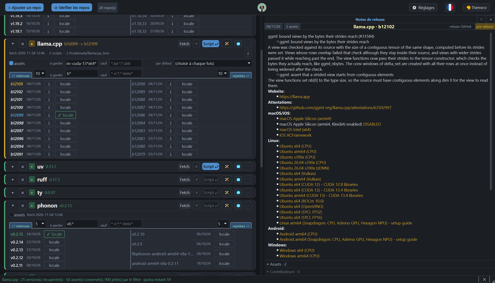

<p align="center">
  
</p>

<h1 align="center"><font size="7">ReleaseWatch</font></h1>

<h2 align="center"><font size="6">
  <p>
    <a href="./readme.md">English</a> |
    <b>Français</b>
  </p>
</font></h2>

<p align="center"><font size="4"><em>
Interface graphique locale qui surveille les releases des dépôts GitHub que vous choisissez : un bandeau par dépôt, deux colonnes de versions (celles que vous gardez, celles que vous écartez), des filtres paramétrables sur les tags et sur les assets, et une version locale que <strong>vous désignez vous-même</strong> pour voir d'un coup d'œil ce qui est à jour. Vous pouvez associer vos propres scripts à chaque dépôt (mise à jour, build, déploiement) et les relancer en un clic. Aucune donnée n'est envoyée ailleurs : l'application ne fait que lire l'API publique de GitHub, en HTTPS.
</em></font></p>

<p align="center">
  
</p>

<div align="center"><font size="4">
<strong>

[⬇️ Télécharger](#telecharger)
[⚙️ Installation](#installation)
[🚀 Fonctionnalités](#fonctionnalités)
[⌨️ Raccourcis clavier](#raccourcis-clavier)
[🗂️ Arborescence du projet](#arborescence-du-projet)
[🧱 Stack technique](#stack-technique)
[📜 Licence](#licence)

</strong></font>

</div>

- **Plateforme** : Windows 10/11 x64 et Linux (scripts `.bat`/`.cmd`/`.ps1` d'un côté, `.sh`/`.bash`/`.zsh` de l'autre — voir [Linux](#linux)).
- **Interface** : français par défaut, bascule français/anglais en un clic sur le drapeau de la barre d'actions.
- **Aucun compte, aucun jeton, aucune donnée envoyée.** L'application ne fait que lire l'API publique de GitHub, en HTTPS uniquement.

## Télécharger

La page [Publications](../../releases) du dépôt contient trois fichiers pour chaque version publiée :

| Fichier | Ce que c'est |
| ------- | ------------ |
| `ReleaseWatch-<version>-windows-x64.zip` | l'exécutable Windows, décompressé dans un dossier (les `Qt6*.dll` restent des fichiers séparés et remplaçables) |
| `ReleaseWatch-<version>-source-windows-x64.zip` | le code source, avec les fins de ligne réglées pour Windows |
| `ReleaseWatch-<version>-source-linux-x64.zip` | le même code source, sans la règle de fins de ligne Windows |

L'exécutable est construit par [la ligne de publication](.github/workflows/release.yml), et cette ligne le **démarre réellement** (fenêtre créée, passe d'affichage faite, arrêt automatique) avant de le mettre en ligne : le fichier publié est le fichier qui a été testé. Pour une construction locale, voir [CONTRIBUTING.md](CONTRIBUTING.md).

---

## Fonctionnalités

- Surveille autant de dépôts GitHub que souhaité, empilés en bandeaux réordonnables par glisser.
- Récupère les dernières versions (les tags lorsque le dépôt n'a pas de releases) et les affiche en deux colonnes.
- Filtre les tags avec deux motifs glob : « à garder » et « sauf ».
- Récupère et filtre les **assets** de chaque version, avec un asset « par défaut » et un bouton de téléchargement par ligne.
- Compare la dernière version autorisée à la **version locale désignée**, en un clic.
- Affiche les notes Markdown de la release, avec ses assets et ses contributeurs cliquables.
- Lance vos propres scripts — `.bat`, `.cmd`, `.ps1` sous Windows, `.sh`, `.bash`, `.zsh` sur Linux — préconfigurés pour un dépôt, chacun dans sa propre fenêtre.
- Relit le thème et les couleurs sans redémarrer (`Ctrl+Maj+P`), pour ajuster `app/palette.py` et `resources/dark.qss`.

## Ce que ReleaseWatch ne fait pas

- **Elle ne consulte jamais ce qui est installé sur la machine.** La version locale est une valeur saisie ou désignée ; le point d'état vert signifie « la dernière version autorisée est la version locale déclarée », pas « vérifié sur le disque ».
- **Elle n'installe rien.** Elle peut télécharger un asset (`.part` puis renommage), jamais l'exécuter.
- **Elle ne gère pas les dépôts privés** : sans jeton, un dépôt privé répond 404 et le bandeau passe en erreur.
- **Elle ne lance pas les scripts elle-même** : elle les confie aux interprètes du système — `cmd.exe` et `powershell.exe` sous Windows, l'interprète annoncé dans le shebang sous Linux. Un script écrit pour l'un des deux systèmes est refusé sur l'autre, avec l'explication affichée.
- Aucun jeton GitHub non plus : voir [Limite de débit GitHub](#limite-de-débit-github).

---

## Prérequis

|                         |                                                                                          |
| ----------------------- | ---------------------------------------------------------------------------------------- |
| Python                  | 3.13 (voir `.python-version`)                                                            |
| Gestionnaire de paquets | [uv](https://docs.astral.sh/uv/) (le dépôt contient `uv.lock`, versions figées)          |
| Dépendances d'exécution | PySide6-Essentials ≥ 6.12 (Qt 6, LGPL), requests ≥ 2.34                                  |

Le **métapaquet `pyside6` n'est volontairement pas utilisé** : il entraîne QtWebEngine, QtPdf, Qt Multimedia et les bibliothèques ffmpeg, qui sont sous GPL et que cette application n'importe jamais. `pyside6-essentials` contient tout ce qui sert, y compris le support SVG derrière les drapeaux de langue. Voir [THIRD-PARTY-NOTICES.md](THIRD-PARTY-NOTICES.md).

## Installation

### Windows

```bat
uv sync
uv run python main.py
```

Le dossier `data\` est créé au premier enregistrement, à côté de l'application.

### Linux

Le lanceur accepte `.sh`, `.bash` et `.zsh`, exécutés par l'interprète annoncé dans leur shebang (repli `/bin/sh`). Le script s'ouvre dans un émulateur de terminal cherché sur le `PATH` — `x-terminal-emulator`, `gnome-terminal`, `konsole`, `xfce4-terminal`, `mate-terminal`, `lxterminal`, `xterm`, `alacritty`, `kitty`, `foot` — et la fenêtre reste ouverte ; un émulateur peut être imposé avec `RELEASEWATCH_TERMINAL=tilix`. Sans terminal ou sans session graphique, la sortie est écrite dans un journal de `data/launches/` et son chemin s'affiche à la barre d'état.

Le script enfant n'hérite jamais de l'environnement de l'application : ni son venv, ni son `PATH`, ni ses variables `uv`, ni un `LD_PRELOAD` pointant dans le dossier de l'application. Les scripts Windows (`.bat`, `.cmd`, `.ps1`) sont refusés sous Linux, et inversement — un `state.json` venu de Windows reste lisible, ses scripts s'y affichent « refusé ». Les noms d'assets restent assainis à la manière Windows : un nom sûr pour Windows est légal sur Linux.

Il faut en plus des bibliothèques système pour Qt :

```bash
sudo apt-get install libgl1 libegl1 libxkbcommon0
uv sync
uv run python main.py
```

---

## Prise en main

1. Barre du haut : cliquer sur **`+ Ajouter un repo`**, coller `https://github.com/owner/repo`, cliquer **`Vérifier`** (l'API est interrogée, le titre se pré-remplit), puis **`Ajouter`**.
2. Sur le bandeau : **`Fetch`**, ou **`⟳ Vérifier les repos`** en haut pour tous les bandeaux non exclus.
3. Ligne de filtres : les deux combos posent les caps (« versions retenues » à gauche, « rejetées ou obsolètes » à droite) ; les deux champs **`à garder`** / **`sauf`** acceptent des globs séparés par `;`, par exemple `v0.2.*` et `*-rc*;*-beta*`. Les deux petits boutons **`↓↑ retenues`** et **`rejetées ↓↑`** affichent ou masquent chaque colonne.
4. Cocher **`assets`** pour activer le recueil des assets : deux champs de globs pour les conserver ou les écarter, et un combo **`par défaut`** qui choisit l'asset proposé au téléchargement. Décocher masque toute la ligne d'assets.
5. Sur une ligne de version, cliquer **`locale`** pour désigner la version installée. Le menu **`⋯`** du bandeau permet aussi de la saisir à la main.
6. Cliquer une version pour lire ses notes dans le panneau de droite (largeur réglable, `Ctrl`+molette pour la taille du texte).
7. **`🛠`** attache des scripts au dépôt, **`Script ⤶`** les relance, **`🌐`** ouvre la page du dépôt dans le navigateur.
8. **`≡`** fait glisser le bandeau pour changer l'ordre, **`⊘`** l'exclut du contrôle global, **`▾`** replie le bandeau sur sa seule ligne de tête.

## Les lignes de versions

Chaque ligne porte la version, une date courte, le bouton de téléchargement de l'asset (lorsque les assets sont actifs) et le bouton **`locale`**. Son rôle est porté par sa couleur, et l'explication complète tient dans son infobulle.

| Rôle de la ligne              | Signification                                                               |
| ----------------------------- | --------------------------------------------------------------------------- |
| Dernière version autorisée    | La plus récente acceptée par le filtre du bandeau                           |
| Dernière autorisée + locale   | C'est aussi la version locale désignée : rien à faire                       |
| Locale, pas la dernière       | La version locale désignée est plus ancienne que la dernière autorisée      |
| Autorisée mais au-delà du cap | Acceptée par le filtre, mais trop loin pour tenir dans la colonne de gauche |
| Refusée par le motif          | Rejetée par « à garder » / « sauf » : jamais comparée à la version locale   |
| Intermédiaire                 | Acceptée par le filtre, entre les deux extrêmes                             |

## État d'un bandeau

L'état visible est **un point coloré**, rien d'autre ; le mot n'existe que dans l'infobulle, pour ne pas voler de largeur au titre.

| État                     | Signification                                                        |
| ------------------------ | -------------------------------------------------------------------- |
| À JOUR                   | La dernière version autorisée est la version locale déclarée         |
| NOUVELLE VERSION         | La dernière version autorisée est plus récente que la version locale |
| HORS RELEASE             | La version locale ne correspond à aucune version autorisée           |
| VERSION LOCALE À DÉFINIR | Aucune version locale désignée                                       |
| ERREUR FETCH             | La récupération a échoué (dépôt introuvable, débit dépassé, réseau)  |

## Notes de la release

Panneau latéral droit : corps Markdown de la release, avec des pastilles date / nombre d'assets / source / pré-release, puis deux sections cliquables — **Assets** (chaque asset du réseau est un bouton pleine largeur) et **Contributeurs**. Un lien `http://`, `file://` ou autre est refusé et tracé dans la barre d'état : seuls les liens `https://` s'ouvrent, après une confirmation.

## Scripts

- Extensions acceptées : `.bat`, `.cmd`, `.ps1` sous Windows ; `.sh`, `.bash`, `.zsh` sur Linux. Un `.ps1` passe par `powershell.exe -NoExit -ExecutionPolicy Bypass -File` ; un script shell passe par l'interprète annoncé dans son propre shebang (`#!/usr/bin/env bash` → `/usr/bin/env bash`), avec `/bin/sh` en repli.
- Le chemin doit être **absolu** : un chemin relatif est refusé, jamais résolu à l'aveugle. Les caractères spéciaux de coquille (`" & | < > ^`) dans un chemin sont refusés au lancement, sur les deux systèmes.
- Chaque script est lancé dans **son propre dossier** (celui renseigné le cas échéant) et dans un environnement débarrassé du venv de l'application : un script qui appelle `python` trouve le Python de l'environnement, pas celui de ReleaseWatch.
- Aucune commande n'est passée par un shell : la ligne de commande est construite en liste.
- Sous Windows, chaque script garde sa propre console. Sur Linux, le script est confié à un émulateur de terminal cherché sur le `PATH` ; sans terminal ou sans session graphique, sa sortie est écrite dans un journal sous `data/launches/` et son chemin est affiché à la barre d'état : un lancement ne peut pas rester invisible.

## Où est conservé l'état

`data/state.json`, **à côté de l'application** (pas dans AppData, pas dans le profil de l'utilisateur). Dans un exécutable construit, c'est le dossier de l'exécutable : l'état, les sauvegardes et les journaux de lancement restent à côté du `.exe`, tandis que le thème et les icônes restent en lecture seule dans le paquet.

- les dépôts surveillés avec tous leurs réglages, les versions récupérées, la version locale désignée ;
- les réglages globaux (nombre de versions par défaut, dossier de téléchargement), la langue, la géométrie de la fenêtre, la largeur et la taille de police du panneau de notes.

Écriture atomique avec sauvegarde `state.json.bak`, cap de lignes conservées qui suit ce que montrent les deux colonnes (versions retenues + versions rejetées, 50 lignes au plafond — un fichier plus ancien et plus gros est tronqué, pas rejeté), et lecture défensive : un `state.json` édité à la main de travers est nettoyé champ par champ au lieu de faire planter l'application.

## Limite de débit GitHub

Sans jeton, l'API anonyme est limitée à **60 requêtes par heure et par IP**. L'application prend deux précautions : deux requêtes simultanées maximum, et une largeur de récupération calculée (`min(50, 3 × (versions retenues + versions rejetées))`) parce que le filtrage des tags se fait après réception. Une erreur 403/429 est affichée dans le bandeau avec le temps d'attente restant.

## Choix de sécurité

Quelques règles non négociables du code :

- HTTPS seulement, et serveurs limités à `github.com` / `githubusercontent.com` et à une liste d'hôtes exacts.
- `allow_redirects=False` sur chaque requête : les redirections sont suivies à la main, saut par saut, chaque saut étant re-validé (HTTPS + liste blanche) et borné à 3 sauts. C'est ce qui empêche un détournement vers un site imitant GitHub. Mettre `session.max_redirects = 0` aurait l'air plus strict et ne le serait pas : requests résout quand même le premier redirection en interne et lève `TooManyRedirects`, donc chaque téléchargement d'asset échouerait.
- `session.trust_env = False` : ni proxy système, ni `~/.netrc`. `verify = True` en dur.
- Les noms d'assets viennent du réseau : ils passent par un assainisseur (traversée de dossier, noms réservés Windows, caractères dangereux, longueur).
- Un téléchargement écrit `.part` puis renomme ; une erreur laisse un `.part` propre, jamais un fichier à moitié écrit.
- Liens des notes : `https://` seulement, filtrés deux fois (panneau puis ouverture). Le seul chemin local autorisé à s'ouvrir est celui d'un fichier déjà téléchargé, par le bouton « 📂 » de sa ligne.

## Raccourcis clavier

| Raccourci ou geste                   | Effet                                                                              |
| ------------------------------------ | ---------------------------------------------------------------------------------- |
| `Ctrl+Maj+P`                         | Relit la palette de couleurs et la feuille de style sans redémarrer                |
| Clic sur une ligne de version        | Donne le focus à la ligne et affiche ses notes                                     |
| `↑` / `↓` (sur une ligne)            | Passe à la ligne de version précédente / suivante                                  |
| `Entrée` ou `Espace` (sur une ligne) | Affiche les notes de cette ligne                                                   |
| Glisser `≡`                          | Réordonne les bandeaux (le trait d'insertion matérialise la destination)           |
| `⊘`                                  | Exclut le bandeau de « ⟳ Vérifier les repos » (le fetch individuel reste possible) |
| `▾`                                  | Replie le bandeau sur sa ligne de tête                                             |
| Drapeau (barre du haut)              | Bascule l'interface entre français et anglais                                      |

## Développement

```bash
uv run pytest                     # 225 tests collectés, interface hors écran, aucun réseau
ruff check .                      # lint (règles et largeur de 120 caractères : ruff.toml, à la racine)
ruff format --check .             # le même découpage, vérifié au lieu d'être appliqué
ty check .                        # types
uv run python tools/audit_net.py  # audit zéro-confiance du code réseau (63 contrôles)
uv run python tools/export_licenses.py  # rassemble les textes de licence des paquets installés
```

[`.github/workflows/ci.yml`](.github/workflows/ci.yml) relance ces mêmes contrôles sur Windows **et** sur
Linux, en parallèle.

## Stack technique

| Élément   | Choix                                                                    |
| --------- | ------------------------------------------------------------------------ |
| Langage   | Python 3.13                                                              |
| Interface | PySide6-Essentials 6.12 (Qt 6, LGPL v3)                                  |
| Réseau    | requests 2.34 (Apache-2.0), API REST GitHub en HTTPS                     |
| Outillage | uv, `uv.lock` (versions figées)                                          |
| Tests     | pytest (225 tests collectés, interface pilotée hors écran, aucun réseau) |
| Qualité   | ruff (lint + découpage), ty (types), `tools/audit_net.py` (audit réseau) |
| Thème     | palette Python + feuille `.qss` avec jetons `$token`                     |
| Livrable  | PyInstaller en `--onedir`, version figée dans `requirements-build.txt`    |

Sens des dépendances, jamais l'inverse : `main.py` → `app/widgets/*` → `app/jobs.py` → `app/github.py` → `app/models.py`. Aucun appel réseau hors `app/github.py`, et jamais dans un slot d'interface.

## Arborescence du projet

```
main.py                      QApplication, langue, thème, fenêtre, `--smoke-test`
app/about.py                 nom, numéro de version affiché, icône, identifiant Windows
app/paths.py                 où l'application a le droit d'écrire, où sont ses ressources en lecture seule
app/widgets/                 bandeaux, lignes de versions, panneaux, dialogues (segmented.py : paires de boutons soudés)
app/jobs.py                  QRunnable + QThreadPool : tout le réseau est là
app/github.py                client GitHub, filtres d'hôtes, téléchargements
app/models.py                modèles persistés, statuts, caps
app/store.py                 data/state.json (lecture défensive, écriture atomique)
app/filters.py               globs de tags et d'assets
app/notes_parse.py           découpage des notes Markdown
app/i18n.py                  textes, table de traduction FR/EN
app/translations/            la table anglaise
app/scripts.py               lancement des scripts utilisateur
app/theme.py                 substitution des jetons $token, re-polish
app/palette.py               SEULE source des couleurs et des tailles
resources/dark.qss           feuille de style (template, jamais de couleur brute)
assets/                      logo (ico, png) et drapeaux svg utilisés par l'interface
docs/images                  captures utilisées par le README
legal/                       texte LGPL-3.0 à joindre, suivi à la main (voir legal/README.md)
tests/                       pytest + manifeste des noms de widgets (tests/contract.py)
tools/audit_net.py           audit réseau, outil de développement
tools/export_licenses.py     assemble licenses/ depuis les paquets installés
tools/make_source_archives.py les deux archives source d'une publication
requirements-build.txt       outils de construction seuls, versions figées (PyInstaller)
.github/workflows/           ci.yml (contrôles sur les deux systèmes), release.yml (les livrables)
```

## Licence

ReleaseWatch est sous **licence MIT** (voir [LICENSE](LICENSE)) : utilisation, modification et redistribution libres.

Les règles des composants tiers sont listées dans [THIRD-PARTY-NOTICES.md](THIRD-PARTY-NOTICES.md), et leurs textes sont assemblés par `tools/export_licenses.py` dans `licenses/`, dossier placé dans le livrable publié. Deux points commandent la façon dont l'exécutable est construit :

- **PySide6 / Qt : LGPL v3.** Le lien reste dynamique et la bibliothèque reste remplaçable : c'est pourquoi la construction utilise PyInstaller en **`--onedir`** (dossier avec les `Qt6*.dll` séparées) et jamais `--onefile` (qui les enferme). La ligne de publication refuse un livrable qui contiendrait un module GPL (QtWebEngine, QtPdf, Qt Multimedia, ffmpeg) ou auquel il manquerait un texte de licence.
- **requests : Apache-2.0.** Son fichier de licence et son `NOTICE` sont joints.
